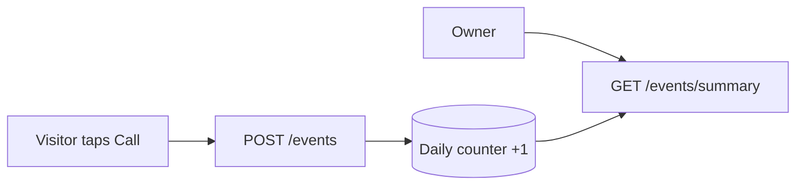

# Click events (route, call, web, save)

Business owners can see how many people tapped "route", "call", "web" or "save" on their business, per campaign and per day. Nothing about the person who clicked is stored: no IP address, no user id, no list of clicks. Only a number per day.

## Reporting a click (apps and web)

`POST /api/v1/businesses/{businessId}/events` with the `session-token` header and a JSON body:

```json
{"type": "CALL", "campaign_id": "optional campaign id of that business"}
```

| Answer | Meaning |
|---|---|
| `204` | Counted (or ignored when the clicker is the owner) |
| `400` | No body, or `type` is not ROUTE, CALL, WEB or SAVE |
| `404` | The business does not exist, or the campaign is not one of that business |
| `429` | Too many clicks from this device on this business; wait the seconds of `Retry-After` |

Sending the same click many times in a burst is safe: after the limit the extra requests are rejected and do not change the counters.

## Seeing the numbers (owner)

`GET /api/v1/businesses/{businessId}/events/summary?from=2026-11-01&to=2026-11-23` with the owner's `session-token`. Without `from` and `to` you get the last 30 days (maximum range: 365 days). You get the total, the total per type, the total per campaign (the entry without `campaign_id` is the clicks that were not tied to a campaign) and one entry per day, with zeros on quiet days.

`401` without a valid session, `403` if you are not the owner, `404` if the business does not exist, `400` for an invalid range.


