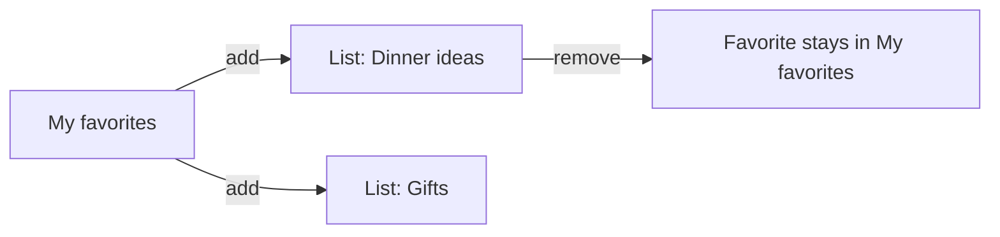

# Favorite lists (user guide)

A signed-in consumer can organise saved stores and products into named lists, for example "Dinner ideas" or "Gifts".

## What you can do
- Create up to 20 lists. Names are unique for you, ignoring upper and lower case ("Gifts" and "gifts" are the same name).
- Rename or delete a list. Deleting a list never deletes your favorites.
- Add a favorite store or product to a list. The same favorite can be in several lists.
- Remove a favorite from a list.
- Open a list to see its favorites, newest first, a page at a time, and see how many favorites each list holds.

## Rules
- Only your own active favorites can be added. If you remove a favorite from your favorites, it stops showing in the lists and in their counts.
- Offers cannot be added to lists, only stores and products.
- You always need to be signed in. Lists of other users are never visible: they behave as if they did not exist.

## Messages you may see
| Situation | Answer |
|---|---|
| Not signed in | 401 |
| List not found or not yours | 404 |
| Name empty or longer than 80 characters | 400 |
| Name already used, or 20 lists reached | 409 |
| Favorite already in the list, or no longer active | 409 |
| Offer favorite | 400 |
