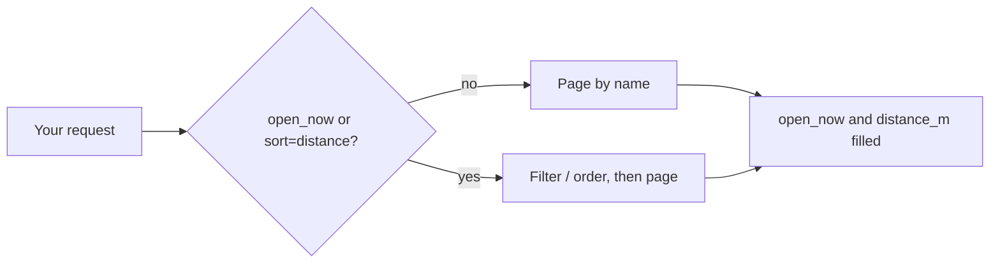

# Search: open now and distance

`GET /api/v1/businesses/search` is public: it needs no `session-token`.

## New result fields

Every business in `data` now also has:

| Field | Meaning |
|---|---|
| `open_now` | `true` if at least one of its locations is open right now, `false` if it has hours but none is open, `null` if it has no opening hours. The time is the one of the business time zone. |
| `distance_m` | Metres from your point to its nearest location. `null` if you did not send `lat` and `lng` or the business has no coordinates. |

Existing fields do not change.

## New optional parameters

| Parameter | Effect |
|---|---|
| `open_now=true` | Only businesses open now (those without hours are left out). `false` or missing: no filter. |
| `lat`, `lng` | Your position. Send both. Fills `distance_m`. |
| `sort` | `name` (default) or `distance` (nearest first; businesses without distance go last). `distance` needs `lat` and `lng`. |

Errors: `400` with the reason in the `message-error` header when only one of `lat`/`lng` is sent, a value is out of range (lat -90..90, lng -180..180), or `sort` is invalid.

## Example

```
GET /api/v1/businesses/search?q=pan&open_now=true&lat=43.65&lng=-79.38&sort=distance&per_page=20
```


