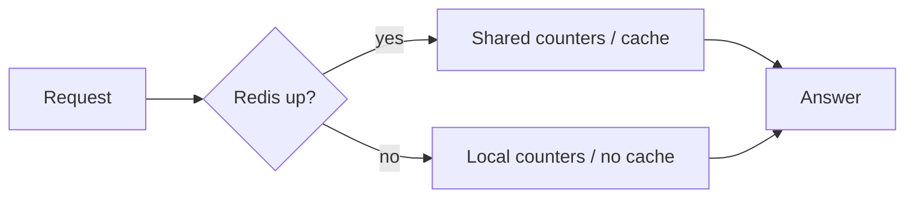

# Redis for rate limiting and the map cache (F4-C)

This guide is for operators and integrators. Both features are optional and off by default: nothing changes until you set the variables below.

## What it does

- **Shared rate limiting.** With several instances behind a load balancer, each instance counts requests on its own. With `UMDC_RATELIMIT_STORE=redis` all instances share the same counters, so a client gets the same quota whichever instance answers. Limits, the `429` answer, `Retry-After` and `X-RateLimit-Limit` are exactly the same as before.
- **Map cache.** With `UMDC_GEO_CACHE_ENABLED=true`, answers of `GET /api/v1/businesses/map` and `GET /api/v1/businesses/nearby` are kept in Redis for a short time, so repeated views of the same area do not hit the database. Cached answers are never specific to a user.

If Redis is down, the service keeps working: rate limiting falls back to per-instance counters and the cache is simply skipped. Users never get an error because of Redis.

## Variables

| Variable | Default | Meaning |
|---|---|---|
| `UMDC_RATELIMIT_STORE` | `memory` | `memory` or `redis` |
| `UMDC_GEO_CACHE_ENABLED` | `false` | turns the map/nearby cache on |
| `UMDC_GEO_CACHE_TTL_SECONDS` | `60` | how long an answer is kept |

Redis connection (already used by the service): `REDIS_URL` (for example `redis://host:6379/0`, or `rediss://` for TLS), `REDIS_PORT`, `REDIS_PASSWORD`, `REDIS_TIMEOUT`, `REDIS_SSL_ENABLED`. Keep the password in the secret store, never in the repository.

## Things to know

- The cache expires only by time: a business that changes can show the old data on the map for up to the TTL.
- When the cache is on, map and nearby searches use a slightly larger area (about 100 m to 1 km depending on zoom) than the one requested, so identical views share one entry.
- Keep the TTL short (the default is 60 seconds).

