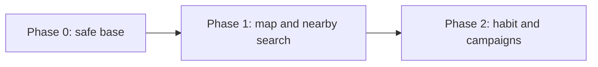

# MVP product analysis (user guide)

This guide explains, in plain language, what the MVP analysis of directory proposes and what it means for the two kinds of users. It changes nothing in the product by itself: it is a plan. The technical detail is in [the technical guide](../technical/mvp-product-analysis.md).

## What we want

- A **business** publishes where its shops are, what it sells and its promotions, in a few minutes.
- A **consumer** finds businesses on a map, saves favourites and picks up an earlier search where they left it.
- Directory becomes the first place people look, because it is quick, nearby and up to date.

## What works today

Businesses, categories, locations with coordinates, search by city, category and text, campaigns, favourites and a private view counter for each business owner.

## What is missing

- Searching **near me** or inside the visible area of the map.
- **Saved searches** and "continue where I left off".
- Sorting favourites (today it fails with an error), and keeping them in lists.
- Product price and image, editing or removing products, and removing campaigns.
- Opening hours and an "open now" label.
- Counting calls, route requests and saves, so a business can see its campaign results.

## What the first phase delivers

1. **Phase 0, safe base.** Only the owner of a business can change its business, products, campaigns and images. Favourites work correctly. Migrations are applied automatically.
2. **Phase 1, map.** The business drops a pin where its shop is. The consumer sees businesses on a map and in a list, sorted by distance, with "open now".
3. **Phase 2, habit.** Saved searches, favourite lists, campaigns with clear states and results (views, route requests, calls, saves), and a free "featured" pilot.

Roughly twelve weeks. The order matters more than the dates.

## For a business

- Set up in under five minutes: business, shop with a pin, first product, first promotion.
- Plain words: "Where is your shop" and "Promotion".
- A preview shows how customers will see it.
- A panel shows views today and in the last 7 days, and later calls and route requests.

## For a consumer

- Open the map, see what is close, filter by category or text.
- Each card shows distance, open or closed, call and directions.
- Save a business with the heart, build lists, save a search.
- If you do not share your location, you can search by city. Your position is used only for that search and is not stored.

## What is left out of the first phase

Reviews, payments, push notifications, alerts for saved searches, recommendations and a native app.

## What we will measure

| Indicator | Starting goal (to validate) |
| --- | --- |
| Businesses with profile, shop and one offer within 7 days | 40% |
| Seeded businesses with a located shop | 80% |
| Monthly active users on day 90 | 1,000 |
| Retention after 30 days | 20% |
| Favourites per active user | 3 or more |
| Businesses that repeat an offer | 50% |

These are targets to test, not market data. Prices for featured placement or sponsored campaigns are not set; they are tested after the free pilots.

## What must be confirmed first

- Whether another library (outside this repository) already checks that the user creating a business is the logged-in user.
- Which map provider is contracted, and its current price.

## Questions

Open an issue in the repository referring to the requirement number (RF-01 to RF-12) from the technical guide.
