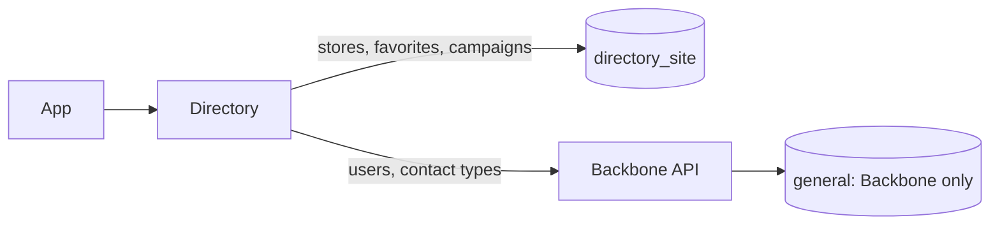

# Data ownership: directory only uses its own database schema (user guide)

## The rule
The directory service stores its data only in the `directory_site` schema. Everything that belongs to the platform account system (users, contact types such as email or website) is owned by Backbone, and directory asks Backbone for it through its API. Directory never reads or writes Backbone's tables.

## What you will notice
Nothing changes in the API: stores, favorites, saved searches and campaigns respond exactly as before.

- Your store keeps its owner, the user in your session token. Only that user can edit the store.
- The email, website, customer-service email and order-management email of a store are still shown. Their type names come from Backbone and are remembered by directory for 10 minutes.
- If Backbone is briefly unavailable, directory keeps using the last names it knows. If it never got them, the store is still returned, only without email and website until Backbone answers again. Reading never fails because of this.

## For operators
The directory database user only has rights on `directory_site`. See the technical guide for the exact grants.
