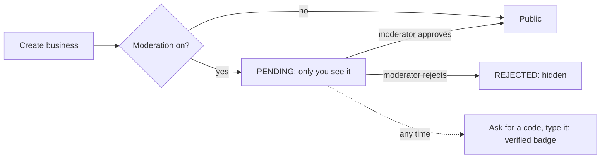

# Business moderation and ownership verification (user guide)

## What changes for business owners
- Every business has a **moderation status**: `PENDING` (waiting for a review), `APPROVED` (public) or `REJECTED` (hidden).
- You can check the status of your own business at any time. You always see your own businesses, whatever their status.
- You can **verify that you own the business**: ask for a code, receive it by e-mail, and type it in. A verified business shows the "verified" badge.

## Is moderation on?
Moderation is **off** until the operators turn it on (`umdc.moderation.enabled=true`). While it is off nothing changes: new businesses are
public at once and every existing business stays public.

When it is **on**:
- A newly created business starts as `PENDING` and is not shown in search, on the map, in "nearby" or on its public page until a moderator approves it.
- Other people get "not found" for a business that is not approved; only its owner can still open it.

## Verifying your business
1. Ask for a code. It is sent to the e-mail of your account. You can ask once per minute.
2. Type the 9-digit code. It is valid for 15 minutes and you have 5 tries; after that, ask for a new one.

## Messages you may see
| Situation | Answer |
| --- | --- |
| Not signed in | 401 |
| The business is not yours | 403 |
| Business not found (or not approved and not yours) | 404 |
| Asked for a code less than a minute ago | 429, wait the seconds in `Retry-After` |
| Wrong code | 400 |
| No code waiting | 409 |
| Code expired | 410 |
| Five wrong codes | 429, ask for a new code |
| The e-mail service is busy or down | 429 / 503, try again later |

## For moderators
Only users whose session token carries the moderator role (default `LH_ADMIN`, configurable) can approve or reject a business. Anyone else gets 403.

## Changes to existing behaviour
- Updating a business (`PATCH /businesses/{id}`) can no longer hand it to another user: sending another user's id in the body answers 403. Sending your own id still works.
