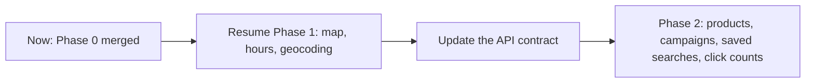

# Pending work and QA release (user guide)

This guide says what is done, what is still pending and what to do to publish the changes in QA. The technical detail and the tables are in [the technical guide](../technical/pending-and-qa-runbook.md).

## What is done

Phase 0 is merged into `development`:
- Only the owner of a business can change it, its image, its products and its campaigns.
- Favourites can be sorted, are paged in the database and can be re-added after deleting them.
- Swagger is closed outside development, requests are limited per minute, and coverage is measured on every build.

The merged result passes the full suite (745 tests) with 93.4 % method coverage.

## What is not done

- **Phase 1** (map search, opening hours, geocoding) stopped before it was finished. Its work is saved and can be resumed.
- **The API contract file** (`api/index.yaml`) does not describe any of the new behaviour yet.
- **Security decisions** are open: whether an owner may hand a business to another user, and whether `POST /products` should carry the business id.
- **The favourites database index** is written but not applied.
- **The SonarQube check** fails in the repository CI, also on `development`; it needs a separate fix.

## What each phase still covers

## Publishing in QA, in short

1. Check that the database already has the earlier scripts (V2 to V5). This release needs no new database script.
2. Leave Flyway off for this release.
3. If QA runs behind a proxy, set `UMDC_RATELIMIT_TRUST_FORWARDED=true`; otherwise all users share one limit and see "too many requests" together.
4. Build and push the JVM image, update the QA tag and restart.
5. Tell the front-end and BFF teams: every write to businesses, products, campaigns and images must send the `session-token` header.
6. Run the twelve smoke tests of the technical guide. If anything fails, go back to the previous image; nothing in the database has to be undone.

## Who is affected

| Component | Action |
| --- | --- |
| directory-backend | build, push and deploy the new image |
| PostgreSQL | check only |
| Config Server / Vault | optional settings |
| Proxy / gateway | check the client IP header |
| BFF and front end | send `session-token`; stop sending the image key; use favourites `sort` if wanted |
| Backbone, Mercury, Kafka, Redis | nothing |
